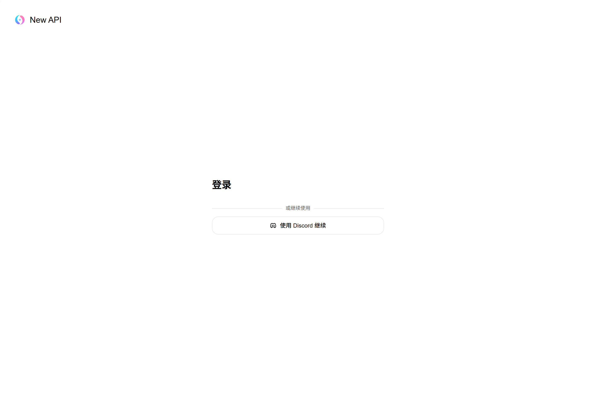
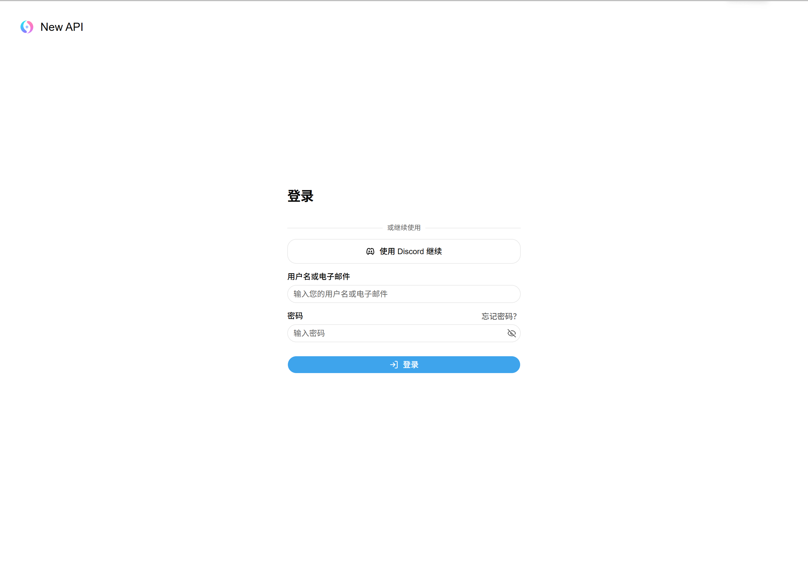
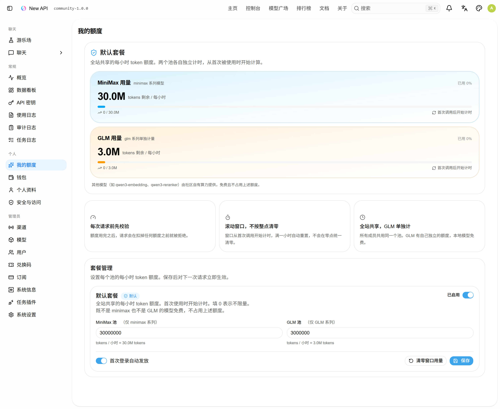
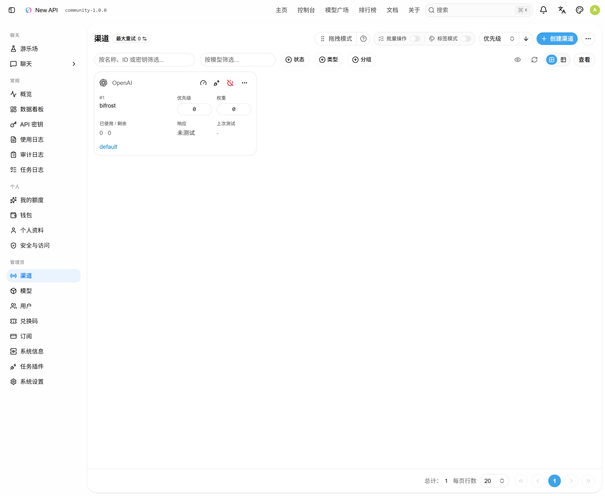
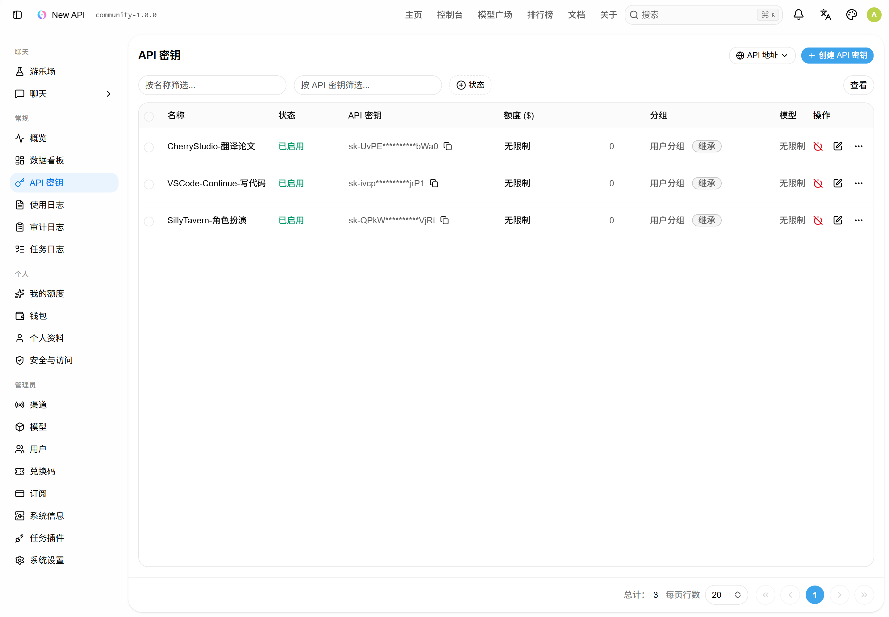
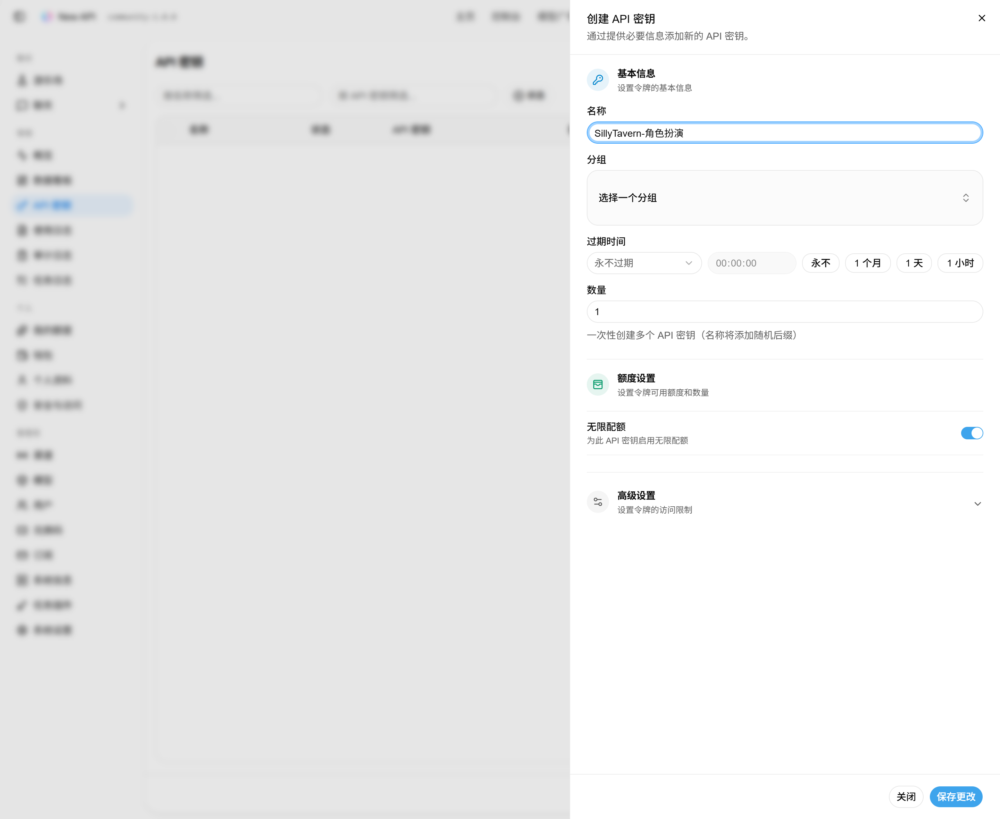

# 类脑 AI 网关 · 部署与使用手册

> 读者：部署这台网关的人（你）。装完之后，你也是这台网关唯一的管理员。
> 全文 15 分钟能读完，真正动手大约 10 分钟。

---

## 0. 一页速览

| 项目 | 内容 |
| --- | --- |
| 安装包 | Releases 页的 `community-gateway-20261104.tar.gz` |
| 需要装什么 | **只要 Docker**，别的都不用 |
| 安装方式 | 解压 → `bash deploy.sh` → 回答 6 组问题 |
| 成员入口 | `https://<你的域名>` → 点「使用 Discord 继续」 |
| 管理入口 | `https://<你的域名>/sign-in?admin=1` |
| 装完必做三件事 | ① 域名指向 `127.0.0.1:3000` ② Discord 回调地址填对 ③ 去「我的额度」确认额度 |

---

## 1. 这东西是什么

```
社区成员的浏览器
    │
    │ ① Discord OAuth2 登录：只验证「是不是类脑成员」
    │   不发邀请码、不建独立账号
    ▼
本网关（一台服务器 / 一个容器 / 一个 SQLite 文件）
    │
    │ ② 每次请求前：查门禁 → 扣全站额度 → 全站限速
    ▼
Bifrost（你自己的路由层，本机 127.0.0.1:8080）
    │
    │ ③ 路由 / 选模型 / 上游密钥 / 失败重试
    ▼
OpenRouter · Z.ai · 本地 AI MAX（qwen3 系列）
```

它只负责两件事：

1. **谁能用** —— 只有类脑社区成员能进来。Discord 一键登录，管理员不用给任何人发账号。
2. **全站能用多少** —— 每小时两个 token 池（MiniMax 30M / GLM 3M），外加每分钟 30 次请求的总闸门。

**路由、上游密钥、模型治理、失败重试，全部留在你的 Bifrost 里**，这个网关不碰、也不需要你重新配一遍。Bifrost 那边新增模型，只要在这个网关的「渠道」里把模型名加进列表就行。

---

## 2. 你需要准备什么

### 2.1 服务器

| 项目 | 要求 | 说明 |
| --- | --- | --- |
| 操作系统 | Linux，x86_64 或 ARM64 都行 | 两种架构的二进制都在包里，脚本自动挑 |
| 内存 | ≥ 1 GB | 实测容器常驻 **34 MB** |
| 磁盘 | ≥ 2 GB | 镜像 311 MB + 空数据库 1.8 MB |
| 本机端口 | 3000 空闲 | 容器**只绑 `127.0.0.1:3000`**，不对外暴露 |

### 2.2 软件

**只需要 Docker**，一条命令：

```bash
curl -fsSL https://get.docker.com | sh
```

装完确认一下：

```bash
docker --version && docker compose version
```

> 不用装 Go、Node、bun、Nginx、MySQL、Redis。运行时镜像里只有一个二进制文件。

### 2.3 网络

- 一个能解析到这台服务器的域名，比如 `ai.你的域名`，并且有 HTTPS 证书。
- 用 Cloudflare Tunnel 的话，**不用开 80/443**，把域名指到 `http://127.0.0.1:3000` 就行。
- 服务器要能出网访问 `discord.com`（换 token 用）。如果这台机器要挂代理才能出网，向导里有一项「容器出网代理」。

### 2.4 提前拿好这四个值

| 值 | 从哪拿 |
| --- | --- |
| Discord Client ID | Developer Portal → 你的应用 → OAuth2 |
| Discord Client Secret | 同上（要 Reset Secret 才会显示明文，只显示一次） |
| Discord 服务器 ID | Discord 里右键服务器 → 复制服务器 ID（需先在设置里打开「开发者模式」） |
| Bifrost 根地址 + 密钥 | 你自己的 Bifrost，形如 `http://127.0.0.1:8080` + `sk-bf-...` |

### 2.5 不需要准备什么

- ❌ 不用建数据库、不用跑迁移脚本
- ❌ 不用配 Nginx 反向代理（Cloudflare Tunnel 就够）
- ❌ 不用给成员发账号、发邀请码
- ❌ 不用自己编译，包里已经是编译好的二进制

---

## 3. 安装

### 3.1 下载

```bash
mkdir -p /opt && cd /opt
curl -LO https://github.com/gaotaichun/community-gateway/releases/download/v1.0.0/community-gateway-20261104.tar.gz
```

### 3.2 校验（30 秒，建议做）

```bash
sha256sum community-gateway-20261104.tar.gz
```

应当输出：

```
e0e41b2533f749b607b4b57b555207a88e3b5779d4e7e3a5c90988690b0a8233  community-gateway-20261104.tar.gz
```

对不上就别装了，重新下载。

### 3.3 解压

```bash
tar -xzf community-gateway-20261104.tar.gz
cd community-gateway-20261104
ls
# Dockerfile  bin  deploy.sh  docker-compose.yml  licenses  preset.env  README.md  .env.example
```

### 3.4 跑向导

```bash
bash deploy.sh
```

六步，全程只有一个交互式脚本。

**1/6 环境检查** —— 检查 Docker、端口 3000、磁盘空间、二进制架构。

**2/6 收集配置** —— 逐项提问，方括号里是默认值，**直接回车即采用**：

| 问题 | 怎么填 |
| --- | --- |
| 站点地址 | `https://ai.你的域名`（**必须**和 Discord 里填的回调地址一致） |
| Client ID | 粘上一步拿到的 |
| Client Secret | 同上 |
| Discord 服务器 ID | 类脑服务器 ID。留空 = 不做门禁（**不建议**） |
| 只允许这些身份组 | **留空**。类脑是「是成员就放行」 |
| 邀请链接 | **留空** |
| 管理员用户名 / 密码 | 你自己定，**务必记下来**，这是后台唯一入口 |
| Bifrost 根地址 | 同机就填 `http://127.0.0.1:8080`（**不带 `/v1`**） |
| Bifrost 密钥 | `sk-bf-...` |
| 对外暴露的模型名 | 逗号分隔，见下方 |
| 全站每分钟最多调用次数 | 默认 30，回车即可 |

模型名填下面这一串（和你 Bifrost 里的一致，**不能有空格**）：

```
Z.ai/glm-5.3-flash,openrouter/minimax/minimax-m3,openrouter/minimax/minimax-m3.1-flash,Local_Bifrost/AI_MAX/qwen3-embedding,Local_Bifrost/AI_MAX/qwen3-reranker
```

> ⚠️ **Bifrost 要监听 `0.0.0.0`（或 docker 网桥地址），不能只听 `127.0.0.1`。**
> 网关跑在容器里，`127.0.0.1` 会被自动改写成 `host.docker.internal`（即 `172.17.0.1`）；
> 如果 Bifrost 只绑定了 `127.0.0.1`，容器是连不上它的，所有请求会 500。

**3/6 连通性校验** —— 会试 `discord.com` 和你的 Bifrost。Bifrost 显示不通不一定是真不通（可能还没起），可以先继续，装完再修。

**4/6 写入 `.env`** —— 生成配置文件，权限 600。

**5/6 构建镜像并启动** —— 从 `bin/` 里挑对应架构的二进制 → `docker build` → 起容器 → 等健康检查。

**6/6 初始化与后台配置** —— 建管理员、写站点地址、打开 Discord 登录、建 `bifrost` 渠道。全部自动。

成功后打印：

```
部署完成

  站点地址      https://ai.你的域名
  回调地址      https://ai.你的域名/oauth/discord
  管理后台      https://ai.你的域名/sign-in?admin=1
  容器           community-gateway（仅监听 127.0.0.1:3000）
  数据卷         community-gateway-data
```

### 3.5 接上域名（两件必做）

**① 把域名指到容器**

Cloudflare Tunnel 的 `config.yml` 长这样：

```yaml
tunnel: <你的-tunnel-id>
credentials-file: /root/.cloudflared/<你的-tunnel-id>.json
ingress:
  - hostname: ai.你的域名
    service: http://127.0.0.1:3000
  - service: http_status:404
```

（用 Nginx 也行，反代到 `http://127.0.0.1:3000` 即可。）

**② Discord 回调地址**

Developer Portal → 你的应用 → OAuth2 → Redirects 里加一条：

```
https://ai.你的域名/oauth/discord
```

**必须一字不差**，多一个斜杠、少一个 `https` 都会报 `redirect_uri_mismatch`。

---

## 4. 打开后台

### 4.1 成员看到的样子



就一个按钮。没有注册、没有密码框、没有邀请码。点它 → Discord 授权 → 是类脑成员就进来了，账号自动创建。

### 4.2 你自己的入口



只有在网址后面加 `?admin=1` 才会出现账密表单：

```
https://ai.你的域名/sign-in?admin=1
```

普通成员访问 `/sign-in` 是看不到这个表单的，所以不用另外藏后台。

---

## 5. 日常管理

### 5.1 改额度（最常用）



左侧「个人 → 我的额度」，页面上半部分是所有人的额度状态，**最下面是「套餐管理」，只有管理员看得到**。

| 池 | 默认 | 管哪些模型 |
| --- | --- | --- |
| MiniMax 池 | 30,000,000 tokens / 小时 | 所有 **非 GLM** 的模型（minimax 系列、embedding、reranker 都在这里） |
| GLM 池 | 3,000,000 tokens / 小时 | 只算 **GLM** 系列，单独一个池，不会被别人挤占 |

几条要点：

- **填 0 = 不限量**。
- 保存后**下一次请求立即生效**，不用重启容器。
- 「清零窗口用量」= 把当前这一小时的已用量归零。有人被额度卡住、又确实该放行时，点这个救急。
- 口径是 **token 数 = 输入 + 输出合计**；**全站共享**，不是每人一份；从**第一次调用**开始计时，满一小时自动重置（不是每天零点清零）。

### 5.2 确认渠道通不通



「渠道」里应该有一条 `bifrost`：类型 OpenAI、分组 `default`、响应列写 `未测试`（刚装好没发过请求，正常）。

- 点卡片右上角的「编辑」能看到完整配置：根地址、密钥、模型列表。
- **尽量不要点「测试」**：这个按钮会真的打一次上游（`/v1/models` 或一条请求），Bifrost 那边可能因此多一条日志、多一次计费或告警。
  要确认通不通，**用成员的 key 发一条真实请求，然后看「日志 → 使用日志」里有没有记录**，这比点测试准得多。
- 上游换了地址或密钥：编辑 → 改 → 保存，立刻生效，不用重启。

### 5.3 管人

「用户」页能看到每个成员：Discord 昵称、注册时间、累计用量。

- 要停某个人的权限：把状态改成「已禁用」，他的 key 立刻失效。
- 他再用 Discord 登录会看到「账号已被禁用」，重新启用后恢复正常。

### 5.4 看用量

「日志 → 使用日志」：每次调用的模型、token 数、耗时、扣了多少额度、有没有被额度拦下来。

想快速看全站今天用了多少：看「数据看板」。

---

## 6. 发给成员的两条规矩（建议直接贴群公告）

### 6.1 密钥命名格式

创建 key 的时候，**必须写清「用什么软件 + 干什么用」**，写不清楚的直接删。



新建的时候名字就填在这里：



| ✅ 合格 | ❌ 不合格 |
| --- | --- |
| `SillyTavern-角色扮演` | `test` |
| `VSCode-Continue-写代码` | `my key` |
| `CherryStudio-翻译论文` | `123` |
| `OpenWebUI-社区问答` | `key1` |
| `Cursor-改项目` | `随便` |

为什么较真：额度是全站共享的，出了异常必须能一眼看出是哪个用途在刷。

### 6.2 禁止任何形式的商业化使用

包括但不限于：

- 出售、转售、出租本站 API 或额度
- 接入商业平台、商业项目、付费项目
- 作为第三方盈利服务的一部分调用
- 账号共享、账号代用、一人多号占用资源

处理顺序：**删掉对应 key → 停用账号 → 封禁 Discord 身份**。

---

## 7. 常见问题

| 现象 | 原因 | 怎么修 |
| --- | --- | --- |
| 点登录报 `redirect_uri_mismatch` | Discord 里登记的回调地址和站点地址不一致 | Developer Portal 里改成 `https://你的域名/oauth/discord` |
| 登录后提示不是社区成员 | 服务器 ID 填错，或他确实不在服务器 | 检查「系统设置」里的 Discord 服务器 ID |
| 所有请求 500，日志写 `do request failed` | 容器连不上 Bifrost | 同机用 `http://127.0.0.1:8080`；并确认 Bifrost 监听 `0.0.0.0` 而不是只听 `127.0.0.1` |
| 400 `has not been priced by the administrator` | 自用模式没开 | 向导已自动打开；手动：系统设置 → 打开「自用模式」 |
| 429 `MiniMax全站额度已用完（已用 30.00M / 上限 30.00M）` | 正常拦截 | 等窗口重置，或去「我的额度」调大 |
| 429 `调用太频繁` | 触发每分钟总限流 | 等 60 秒；确实需要就调大 `GLOBAL_RATE_LIMIT_PER_MINUTE` |
| 重跑 `deploy.sh` 最后一步「登录失败」 | 数据卷里有旧数据，旧管理员密码 ≠ 这次填的 | 改 `.deploy-config` 里的 `ADMIN_PASS` 为旧密码重跑；或 `docker compose down -v` 清空重来（**会丢数据**） |
| 启动报端口被占用 | 有旧容器还在 | `docker compose down` 后重试 |
| 成员说额度一直是 0 | 套餐被设成 0（= 不限量）或套餐被停用 | 「我的额度 → 套餐管理」检查两个池的值和「已启用」开关 |

---

## 8. 备忘

### 8.1 常用命令

```bash
cd /opt/community-gateway-20261104

docker compose logs -f          # 看日志
docker compose restart          # 重启
docker compose down             # 停止（数据保留在数据卷里）
docker compose up -d            # 再启动
```

### 8.2 数据在哪

全部在 Docker 数据卷 `community-gateway-data` 里（SQLite 数据库 + 日志）。**容器删了数据还在**，只有 `docker compose down -v` 会连数据一起删。

### 8.3 备份

```bash
docker run --rm \
  -v community-gateway-data:/data \
  -v "$PWD":/backup \
  debian:bookworm-slim \
  tar czf /backup/gateway-$(date +%F).tar.gz -C /data .
```

恢复时把包解回同名数据卷即可。

### 8.4 升级

换新版本的包，解压后把 `bin/` 里的二进制替换掉，然后：

```bash
docker compose up -d --build
```

数据卷不动，用户、密钥、额度记录全部保留。

---

有任何一步卡住，把 `docker compose logs --tail=100` 的输出发出来，对着第 7 节的表基本都能定位。
